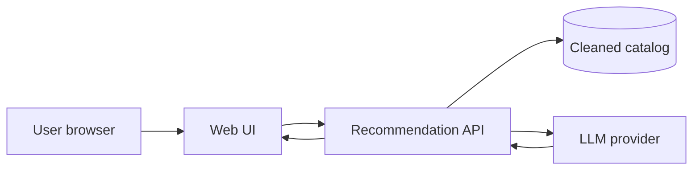
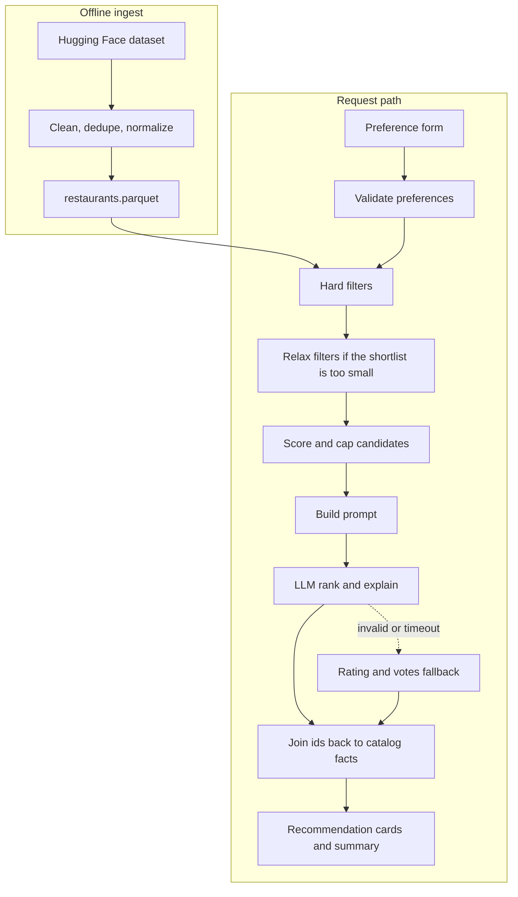
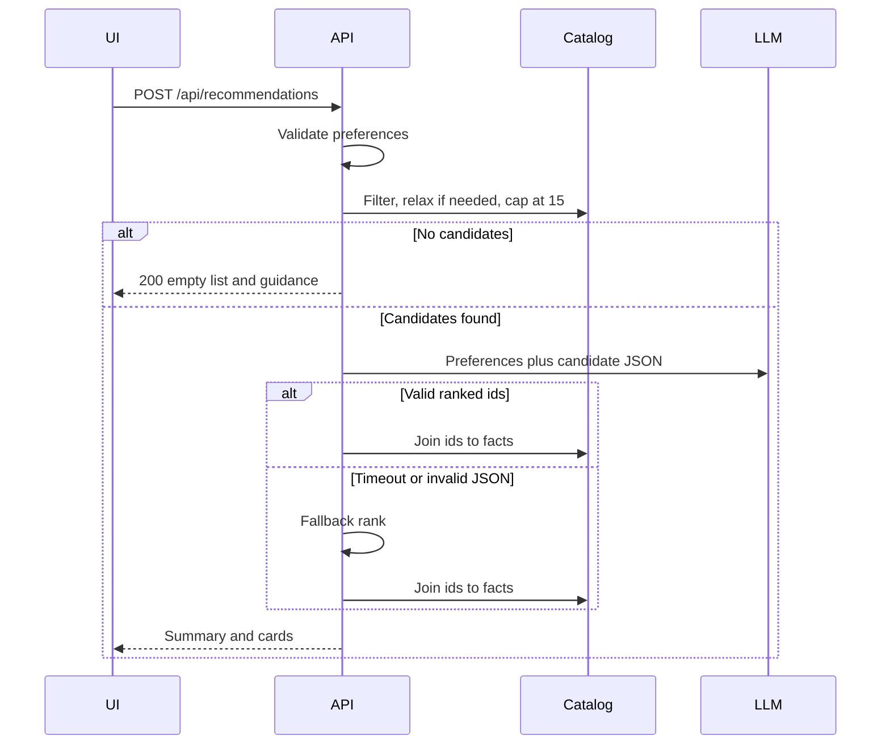

# Architecture: AI-Powered Restaurant Recommendation System

This document describes how to build the service defined in [problemStatement.md](problemStatement.md). Structured filters select real restaurants from the Zomato dataset. A large language model ranks that shortlist and writes the explanations the user sees.

## 1. Goals

The application must:

- Accept location, budget, cuisine, a minimum rating, and free-text preferences such as family-friendly or quick service.
- Recommend restaurants that exist in the [ManikaSaini/zomato-restaurant-recommendation](https://huggingface.co/datasets/ManikaSaini/zomato-restaurant-recommendation) dataset.
- Show a short ranked list. Each card includes restaurant name, cuisine, rating, estimated cost, and an AI-written explanation.
- Include an optional one-paragraph summary of the set.

The model explains and orders options. It does not invent restaurants, ratings, or prices. Those fields always come from the cleaned catalog.

## 2. Dataset constraints

The Hugging Face dataset has **51,717 rows** and is about **574 MB**, almost entirely because `reviews_list` can be enormous. Serving and prompting use a cleaned catalog, which is a few megabytes.

| Source column | Type in the dataset | Role in this system |
| --- | --- | --- |
| `name` | string | Display name |
| `address` | string | Identity and display |
| `location` | 93 locality values | Primary location filter (Banashankari, Indiranagar, …) |
| `listed_in(city)` | 30 area values | Secondary area label, aggregated onto the restaurant |
| `cuisines` | comma-separated string, sometimes empty | Cuisine filter and display |
| `approx_cost(for two people)` | numeric string, sometimes with commas | Budget filter and estimated cost |
| `rate` | strings such as `4.1/5`, `NEW`, `-`, or empty | Parsed rating |
| `votes` | integer | Confidence signal for pre-ranking |
| `rest_type` | comma-separated string | Helps the model judge quick service, cafes, dining |
| `dish_liked` | comma-separated string, often empty | Extra context for explanations |
| `online_order`, `book_table` | `Yes` / `No` | Context for the explanation |
| `listed_in(type)` | Buffet, Cafes, Delivery, Desserts, Dine-out, Drinks & nightlife, Pubs and bars | Aggregated tags |
| `reviews_list` | very large text | Reduced to a short snippet at ingest, then dropped |
| `url`, `phone`, `menu_item` | string | Dropped. Phone numbers are not stored or shown |

Every row is a Bangalore listing. `location` is a locality inside Bangalore, so the problem statement’s city examples (Delhi, Bangalore) do not match the column values. The location control is a locality picker filled from the catalog. A request for a city name that is not a locality returns the known localities so the user can choose one.

The same restaurant appears on many rows because Zomato repeats it under different `listed_in(type)` and `listed_in(city)` values. Ingest collapses those rows into one restaurant.

## 3. Design principles

1. **Filter before the model.** Location, cuisine, rating, and budget are applied in code. The model receives a capped candidate list.
2. **Catalog is the source of facts.** The response joins model output back to catalog fields by restaurant id.
3. **Soft preferences stay in the prompt.** “Family-friendly” and “quick service” have no dedicated columns. The model infers them from restaurant type, liked dishes, listing tags, and a short review snippet.
4. **Bounded context.** Full reviews never enter a prompt. Candidates are capped (default 15). Explanations are capped in length.
5. **A deterministic path still returns results** when the model is unavailable or returns invalid JSON. That path ranks by rating and votes and says the explanation was generated without the model.

## 4. System context



The browser talks only to this application. The dataset is loaded once into the cleaned catalog. The LLM provider is called from the server with an API key that never reaches the browser.

## 5. Logical architecture



### 5.1 Ingest pipeline

Runs as a script before the API starts, and again whenever the dataset should be refreshed. It does not run on the user request path.

Steps:

1. Load `ManikaSaini/zomato-restaurant-recommendation` with the Hugging Face `datasets` library.
2. Normalize text: strip whitespace, fix obvious encoding damage in names where it is safe, and split comma-separated fields into lists.
3. Parse `rate` into a float from `0` to `5`. Treat `NEW`, `-`, and blank as missing.
4. Parse `approx_cost(for two people)` into an integer. Remove commas. Treat blank values as missing.
5. Map `Yes` / `No` to booleans.
6. From `reviews_list`, keep at most two short review excerpts, each truncated (about 280 characters). Discard the raw column.
7. Deduplicate on a stable id: lowercase `name` plus normalized `address`. Merge list fields with a set union. Keep the highest `votes`, and keep the rating attached to that vote count. Keep a non-null cost and a non-null snippet when any duplicate has one.
8. Drop rows with no name. Keep rows with a missing rating or cost; filters decide later whether they qualify.
9. Write `data/restaurants.parquet` plus a small `data/catalog_meta.json` containing the locality list, cuisine list, and row count.

### 5.2 Catalog service

Loads the parquet file into memory at process start. Exposes:

- `list_localities()` and `list_cuisines()` for the form
- `filter(preferences) -> list[Restaurant]`
- `get_many(ids) -> list[Restaurant]`

Fifty thousand source rows collapse to a much smaller unique-restaurant set and no longer include raw reviews, so an in-memory catalog is enough. A database can replace this later behind the same interface.

### 5.3 Preference validation

| Field | Rule |
| --- | --- |
| `location` | Required. Case-insensitive match to a known locality. |
| `budget` | Required. One of `low`, `medium`, `high`. |
| `cuisine` | Optional. Case-insensitive match against any cuisine token. Blank means any cuisine. |
| `min_rating` | Optional. Float from `0` to `5`. Default `0`, which keeps unrated restaurants eligible. A value above `0` excludes missing ratings. |
| `additional_preferences` | Optional free text, length-capped (about 300 characters). |
| `top_n` | Optional. Default `5`, maximum `8`. |

Unknown locality or cuisine returns `400` with a short list of close matches when any exist.

### 5.4 Hard filters and budget bands

A restaurant matches when all of the following hold:

- `location` equals the requested locality
- at least one cuisine token equals the requested cuisine, when a cuisine was provided
- `rating >= min_rating` when `min_rating > 0`
- `cost_for_two` falls inside the budget band

Initial cost-for-two bands, in Indian rupees, kept in configuration so they can be retuned after a histogram of `cost_for_two`:

| Budget | Cost for two |
| --- | --- |
| low | 500 and below |
| medium | 501 to 1,000 |
| high | above 1,000 |

Restaurants with a missing cost fail the budget filter. The empty-result message can say that some places were skipped because cost is unknown.

### 5.5 Pre-rank and relaxation

Candidates are ordered by:

```text
score = rating * log(1 + votes)
```

Missing ratings sort last. The prompt receives the top **15** by this score.

When fewer than **3** restaurants match, filters relax in this order, stopping as soon as 3 or more matches exist:

1. Widen budget by one adjacent band (`low` also allows medium, `medium` allows low and high, `high` also allows medium).
2. Drop the cuisine constraint.
3. Lower `min_rating` by `0.5`, down to `0`.

Location stays fixed. Each relaxation is recorded and shown in the response as `filters_applied`, so the UI can say the search was broadened.

When the relaxed query is still empty, the API returns an empty recommendation list and a summary that asks the user to change locality or rating. The model is not called.

### 5.6 Prompt and model

One chat completion per request. The system message fixes the job and the output shape. The user message carries preferences plus the candidate records.

Candidate payload per restaurant:

- `id`, `name`, `cuisines`, `rating`, `votes`, `cost_for_two`
- `rest_type`, `listed_types`, `dish_liked` (capped), `online_order`, `book_table`
- `review_snippet` when present

Instructions to the model:

- Rank only these ids, best fit first.
- Use `additional_preferences` as the main tie-breaker. Use rating and votes when preferences do not distinguish two places.
- Explain each pick in two or three sentences using only the supplied fields.
- Write `summary` as a short comparison of the set.
- Return JSON only, matching the schema below.
- Put at most `top_n` items in `recommendations`.

```json
{
  "summary": "string",
  "recommendations": [
    {
      "id": "string",
      "rank": 1,
      "explanation": "string"
    }
  ]
}
```

Provider settings live in environment variables: `LLM_API_KEY`, `LLM_BASE_URL`, `LLM_MODEL`. The default provider is Groq at `https://api.groq.com/openai/v1` with model `openai/gpt-oss-120b`. That model’s Groq limits are 30 requests/minute, 1,000 requests/day, 8,000 tokens/minute, and 200,000 tokens/day. Reasoning tokens count. The client keeps those windows in memory, reserves the worst case before the request, and replaces it with the reported usage afterward. One search sends one completion. A local refusal or a rate-limit response uses the fallback ranker and is not retried. The client speaks the OpenAI chat-completions API so another provider can be selected without changing the ranker. Temperature stays low (`0.2`) so rankings are stable. A timeout of about 20 seconds bounds the request.

The response is parsed as JSON. Markdown fences are stripped if the model adds them. Ids absent from the candidate set are discarded. Duplicate ids are discarded. If nothing valid remains, the fallback ranker runs.

### 5.7 Response assembly

For each surviving id, in rank order, the API attaches catalog facts:

- `name`
- `cuisines`
- `rating`
- `cost_for_two`
- `explanation` from the model
- `address`, `rest_type`, `online_order`, and `book_table` as secondary details the card may show

`explanation_source` is `llm` or `fallback`. `filters_applied` lists the constraints that actually ran, including any relaxation.

### 5.8 Fallback ranker

Used when the provider errors, times out, or returns no usable ids. It keeps the pre-rank order, takes `top_n`, and fills a plain explanation from rating, votes, cuisine, and cost. `summary` states that the list is ordered by rating and popularity because a written recommendation was unavailable.

## 6. Request lifecycle



## 7. HTTP API

### `GET /api/meta`

Returns data the form needs: localities, cuisines, budget options, and the default minimum rating. The UI calls this on load.

### `POST /api/recommendations`

Request:

```json
{
  "location": "Banashankari",
  "budget": "medium",
  "cuisine": "Italian",
  "min_rating": 4.0,
  "additional_preferences": "family-friendly, quick service",
  "top_n": 5
}
```

Response:

```json
{
  "summary": "A short comparison of the picks.",
  "explanation_source": "llm",
  "filters_applied": {
    "location": "Banashankari",
    "budget": "medium",
    "cuisine": "Italian",
    "min_rating": 4.0,
    "relaxed": []
  },
  "candidate_count": 15,
  "recommendations": [
    {
      "rank": 1,
      "id": "jalsa|942, 21st main road, 2nd stage, banashankari, bangalore",
      "name": "Jalsa",
      "cuisines": ["North Indian", "Mughlai", "Chinese"],
      "rating": 4.1,
      "votes": 775,
      "cost_for_two": 800,
      "address": "942, 21st Main Road, 2nd Stage, Banashankari, Bangalore",
      "rest_type": ["Casual Dining"],
      "online_order": true,
      "book_table": true,
      "explanation": "Why this place fits the request."
    }
  ]
}
```

Status codes:

| Code | When |
| --- | --- |
| 200 | A ranked list, an empty list with guidance, or a fallback list |
| 400 | Invalid preference payload |
| 500 | Catalog failed to load |

Model failure stays on the 200 fallback path so the page still shows restaurants.

## 8. User interface

A single page:

1. **Form.** Locality dropdown from `/api/meta`, budget select, cuisine input with suggestions, minimum-rating slider, and a text box for extra preferences. Submit calls `POST /api/recommendations`.
2. **Status line.** Shows the filters that ran and, when present, which constraints were relaxed. Shows when explanations came from the fallback ranker.
3. **Summary.** The paragraph from `summary`, hidden when the list is empty.
4. **Cards.** One card per recommendation, in rank order: name, cuisine, rating, estimated cost for two, and the explanation. Address and restaurant type sit in smaller type under the name.

Empty state copy tells the user to pick another locality or a lower rating. The page disables the button while a request is in flight.

The first version serves this page from the same process as the API. A separate frontend can replace it later because the HTTP contract above is the boundary.

## 9. Technology choices

| Concern | Choice | Why |
| --- | --- | --- |
| Language | Python 3.11+ | Direct fit for the dataset libraries and a small API |
| API | FastAPI | Typed request and response models, one process for API and page |
| Schemas | Pydantic | Validation at the boundary and a JSON schema for the model output |
| Ingest | `datasets`, `pandas`, `pyarrow` | Load Hugging Face data and write parquet |
| Catalog | Parquet loaded at startup | Simple, fast, and small after review text is removed |
| LLM | Groq via OpenAI-compatible chat completions | Default model is `openai/gpt-oss-120b`. Another provider is a base URL and model change |
| UI | Server-rendered page plus a small script | Enough for the form and cards without a second toolchain |
| Config | Environment variables | API key and model name stay out of source |
| Tests | `pytest` | Filters, parsing, and response assembly without a live model |

## 10. Repository layout

```text
Zomato_Jw/
  problemStatement.md
  architecture.md
  pyproject.toml
  .env.example
  pipeline/
    ingest.py              # load, clean, dedupe, write parquet
  data/                    # generated, not committed
    restaurants.parquet
    catalog_meta.json
  app/
    main.py                # FastAPI app and startup catalog load
    config.py
    schemas.py             # request, restaurant, recommendation response
    catalog.py             # load and query the parquet catalog
    filters.py             # hard filters, budget bands, relaxation
    prompt.py              # system prompt and candidate payload
    llm.py                 # provider call and JSON parse
    ranker.py              # orchestrates filter, model, fallback, join
    static/
      index.html
      app.js
      styles.css
  tests/
    test_ingest.py
    test_filters.py
    test_ranker.py
```

## 11. Configuration

`.env.example`:

```text
LLM_API_KEY=
LLM_BASE_URL=https://api.groq.com/openai/v1
LLM_MODEL=openai/gpt-oss-120b
CANDIDATE_LIMIT=15
DEFAULT_TOP_N=5
LLM_TIMEOUT_SECONDS=20
```

Budget thresholds live in `app/config.py` next to the relaxation rules so tests can pin them.

## 12. Failure behavior

| Situation | Behavior |
| --- | --- |
| Parquet missing at startup | Process fails fast with a message to run ingest |
| Unknown locality or cuisine | 400 and suggested values |
| Filters match nothing, even after relaxation | 200, empty list, guidance, model not called |
| Model timeout, HTTP error, or unparseable JSON | Fallback ranking, `explanation_source = fallback` |
| Model cites an unknown id | Id dropped; remaining ids kept |
| Missing rating or cost on a row | Excluded only when the active filter needs that field |

## 13. Non-functional notes

- **Latency.** Filtering is in-memory and should stay well under 100 ms. End-to-end time is dominated by the model call.
- **Cost.** One completion per search, with at most 15 compact candidates. Review text is already truncated.
- **Privacy.** Phone numbers and raw review dumps are removed at ingest. Preference text is sent to the model provider and is not written to a database.
- **Reproducibility.** Ingest is deterministic for a given dataset revision. Fallback ranking is deterministic. Model ranking can vary slightly between calls.

## 14. Build order

1. Ingest script and parquet schema, with tests for rate parsing, cost parsing, and dedupe.
2. Catalog load and meta endpoint.
3. Filters, budget bands, pre-rank, and relaxation, with tests that do not call a model.
4. Prompt, LLM client, JSON validation, and fallback.
5. `POST /api/recommendations` joining ids to catalog facts.
6. Form and result cards against the API.
7. Manual pass: a locality that returns many Italian places, a locality with no matches, a request with the model key removed to confirm fallback, and a free-text preference such as quick service to confirm it shows up in the explanation.
