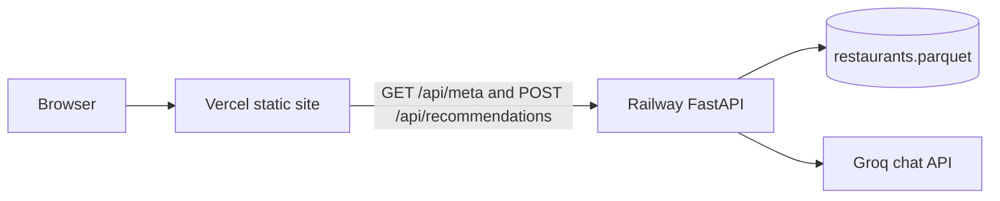

# Deployment Plan: Railway API and Vercel Frontend

Deploy the restaurant recommender as two public services:

- **Railway** runs the FastAPI process: catalog load, filters, ranking, and the Groq call.
- **Vercel** serves the latest frontend, the Stitch page in `app/static` (`index.html`, `app.js`, `styles.css`).

The browser on Vercel calls the Railway API directly. The Groq key never leaves Railway. The raw Stitch export under `stitch_bangalore_restaurant_recommender/` is design source only and is not deployed.



Railway can still serve `/` and `/static` from the same process. That copy stays same-origin and is useful as a fallback. The public UI is the Vercel URL.

## What is already true in this repo

| Fact | Consequence for deploy |
| --- | --- |
| API is `GET /api/meta` and `POST /api/recommendations` in `app/main.py` | These two routes are the only contract the Vercel page needs |
| Frontend fetches those paths with no host (`app/static/app.js`) | A split deploy needs a base URL. Empty base URL must keep today’s same-origin behavior |
| HTML loads `/static/app.js` and `/static/styles.css` | The Vercel output must keep that `/static/` layout |
| Startup loads `data/restaurants.parquet` or refuses to boot | The cleaned catalog has to be in the Railway image. It is about 3.5 MB, 12,494 restaurants |
| `data/` is gitignored, and this folder is not a git repo yet | Railway and Vercel both deploy from GitHub, so the catalog exception and the first push come before either platform |
| `LLM_API_KEY` is read from the environment in `app/config.py` | Set it only as a Railway variable. Do not commit `.env` and do not add the key to Vercel |
| `datasets` is imported only inside `pipeline/ingest.py` | Ingest stays a local script. The API image does not need `datasets` or `pandas` |
| The Groq budget in `app/llm.py` is in-memory per process | Run one Railway replica. A second replica would each have its own budget and could exceed Groq’s caps |
| `pyproject.toml` requires Python `>=3.11` | The image uses Python 3.12 |

There is no CORS middleware, no health route, and `python -m` binds `127.0.0.1`. Those three gaps are fixed in the prep phase below. Platform clicks come after that.

## Phase 0 — Make the split deployable

Do this in the repo before creating either project. A phase is done when its exit checks pass.

### 0.1 Track the cleaned catalog

`data/` cannot stay fully ignored, or the GitHub build will not contain the parquet and Railway will exit on startup with the ingest instruction.

Change `.gitignore` so the directory is ignored except the two ingest outputs:

```gitignore
data/*
!data/restaurants.parquet
!data/catalog_meta.json
```

Leave `.env`, `.venv/`, and `__pycache__/` ignored. Do not commit `.env`.

Ingest still runs on a developer machine (`python -m pipeline.ingest`). Refreshing production means re-running ingest locally, committing the new parquet, and redeploying Railway. The request path does not download Hugging Face.

### 0.2 Health check

Add `GET /api/health` in `app/main.py`. It returns 200 only after the catalog has loaded:

```json
{ "status": "ok", "restaurants": 12494 }
```

Railway uses this path. It must not call Groq.

### 0.3 CORS for the Vercel origin

Add `CORSMiddleware` and read allowed origins from the environment.

| Variable | Value |
| --- | --- |
| `CORS_ORIGINS` | Comma-separated exact origins. Start empty locally. After Vercel exists, set the production origin, for example `https://your-app.vercel.app` |
| `CORS_ORIGIN_REGEX` | `https://.*\.vercel\.app` so preview deployments work without a Railway redeploy for every preview URL |

Allow methods `GET`, `POST`, and `OPTIONS`, and the header `Content-Type`. Do not allow credentials. The page does not send cookies.

Same-origin use (local `uvicorn`, and the page Railway itself serves) does not need these headers.

### 0.4 Frontend API base URL

Keep `/api/meta` and `/api/recommendations` as path strings so `tests/test_ui.py` still passes. Prefix them with a base that is empty unless the host page sets one:

```javascript
const API_BASE = String(window.API_BASE || "").replace(/\/$/, "");

fetch(`${API_BASE}/api/meta`)
fetch(`${API_BASE}/api/recommendations`, { method: "POST", ... })
```

Do not hardcode a Railway URL in `app/static`. Local and Railway-served pages leave `window.API_BASE` unset and keep calling the same origin.

### 0.5 Vercel build output

Add `scripts/prepare-frontend.mjs` and `vercel.json`.

The script copies the three static files into `frontend-dist/` like this:

```text
frontend-dist/index.html
frontend-dist/static/app.js
frontend-dist/static/styles.css
```

Before writing `index.html`, it inserts one line ahead of the app script when `API_BASE` is set:

```html
<script>window.API_BASE = "https://your-service.up.railway.app";</script>
<script src="/static/app.js" defer></script>
```

`API_BASE` must be an origin only, with no path and no trailing slash. The script rejects a value that does not start with `https://`.

```json
{
  "framework": null,
  "buildCommand": "node scripts/prepare-frontend.mjs",
  "outputDirectory": "frontend-dist"
}
```

Add `frontend-dist/` to `.gitignore`.

### 0.6 Railway image

Add a `Dockerfile` so the API image stays small and always contains the catalog. Install the serving set only:

- `fastapi`
- `uvicorn`
- `pydantic`
- `pyarrow`
- `httpx`

Do not install `datasets` or `pandas` in this image. Copy `app/`, `pipeline/` (imported by the package layout), and both files in `data/`.

Start command, so Railway can inject the port:

```bash
uvicorn app.main:app --host 0.0.0.0 --port ${PORT:-8000}
```

`Dockerfile` CMD must be shell form, or `${PORT}` will not expand.

Add `.dockerignore` for `.venv`, `.git`, `.env`, `tests`, `stitch_bangalore_restaurant_recommender`, `__pycache__`, and `.pytest_cache`. Do not ignore `data/restaurants.parquet` or `data/catalog_meta.json`.

Add `railway.toml`:

```toml
[build]
builder = "DOCKERFILE"
dockerfilePath = "Dockerfile"

[deploy]
healthcheckPath = "/api/health"
healthcheckTimeout = 60
restartPolicyType = "ON_FAILURE"
restartPolicyMaxRetries = 5
```

Leave replica count at 1.

### 0.7 Exit checks

- `pytest` is green, including `tests/test_ui.py`.
- `GET /api/health` returns 200 and a restaurant count when the parquet is present.
- With `window.API_BASE` unset, the page still requests `/api/meta`.
- `frontend-dist/index.html` from `API_BASE=https://example.up.railway.app node scripts/prepare-frontend.mjs` contains that origin and still references `/static/app.js`.
- `git status` does not list `.env`.
- `git check-ignore -v data/restaurants.parquet` does not ignore that file.

## Phase 1 — GitHub

Railway and Vercel deploy from a Git host. This workspace has no commits yet.

1. Create an empty GitHub repository.
2. Initialize git in this folder, commit the app, the cleaned catalog, the Docker and Vercel files, and the docs.
3. Confirm `.env` is not in the commit. If it was staged, unstage it and rotate the Groq key, because a pushed key has to be treated as public.
4. Push the default branch.

Exit check: the GitHub repo contains `data/restaurants.parquet`, `Dockerfile`, `vercel.json`, and `app/static/index.html`, and does not contain `.env`.

## Phase 2 — Railway backend

Do this before Vercel. The frontend build needs the public API origin.

1. In Railway, create a project and a service from the GitHub repo. Leave the root directory as the repo root so the `Dockerfile` is used.
2. Set variables on the service. Names match `app/config.py` and the CORS settings from Phase 0.

| Variable | Required | Value |
| --- | --- | --- |
| `LLM_API_KEY` | Yes, for model wording | The Groq key from the local `.env`. Railway only |
| `LLM_BASE_URL` | No | `https://api.groq.com/openai/v1` |
| `LLM_MODEL` | No | `openai/gpt-oss-120b` |
| `LLM_TIMEOUT_SECONDS` | No | `20` |
| `CANDIDATE_LIMIT` | No | `15` |
| `DEFAULT_TOP_N` | No | `5` |
| `CORS_ORIGINS` | After the Vercel production URL exists | `https://<project>.vercel.app` |
| `CORS_ORIGIN_REGEX` | Yes, once Phase 0 is in | `https://.*\.vercel\.app` |

Unset variables already fall back to those Groq defaults. Do not set `PORT`. Railway sets it.

3. Generate a public domain (`*.up.railway.app`).
4. Deploy and wait until the health check is green. The first boot only reads the parquet. It does not call Groq and it does not run ingest.
5. Confirm one replica.

Exit checks, from a machine that is not the server:

- `GET https://<railway>/api/health` returns 200 and `"restaurants": 12494` (or the current catalog count).
- `GET https://<railway>/api/meta` returns 200 and includes `Banashankari`.
- `GET https://<railway>/` returns the search page. This is the same-origin fallback, not the Vercel site.
- `POST https://<railway>/api/recommendations` with `{"location":"Banashankari","budget":"medium","cuisine":"Italian","min_rating":4}` returns 200, cards whose rating and cost come from the catalog, and `explanation_source` of `llm` when the key is valid.
- The response headers do not include the Groq key.

If health fails and the deploy log says to run ingest, the parquet was not in the build context. Fix Phase 0.1 and the Docker `COPY`, then redeploy. Do not SSH in and download Hugging Face on the service.

## Phase 3 — Vercel frontend

1. Import the same GitHub repo as a Vercel project. Framework preset is Other. Root directory is the repo root. The build command and output directory come from `vercel.json`.
2. Set `API_BASE` for Production and Preview to the Railway origin from Phase 2, for example `https://<service>.up.railway.app`. No path, no trailing slash.
3. Do not set `LLM_API_KEY` or any other secret on Vercel. This project has no server code.
4. Deploy.
5. Copy the production URL into Railway `CORS_ORIGINS` and redeploy Railway once. Preview URLs on `*.vercel.app` are already covered by `CORS_ORIGIN_REGEX`.
6. Optional later: add a custom domain on Vercel, then append that origin to `CORS_ORIGINS` and redeploy Railway.

Exit checks in a browser on the Vercel URL, desktop width:

- The page title is “Bangalore Restaurant Recommendation Tool” and the heading is “Find a table”.
- The locality dropdown is filled. Banashankari can be selected. Cuisine suggestions appear. This proves `GET /api/meta` reached Railway.
- A search for Banashankari, medium budget, Italian, minimum rating 4 shows cards. Cost and rating match the JSON from `POST /api/recommendations`.
- The button stays disabled while the request is in flight.
- DevTools shows the API host as the Railway origin, and the Groq key is absent from the page source, the JS bundle, and the request headers.

## Phase 4 — Walkthrough on the public URLs

Run these against the Vercel page with the Railway API behind it.

| Check | Expected |
| --- | --- |
| Banashankari, medium, Italian, minimum rating 4 | Several cards. Names exist in the catalog. Explanations mention cuisine, cost, or rating from that row |
| A locality, cuisine, and rating that no relaxation can fill | Empty state and guidance. No model-error banner |
| Same rich search after removing `LLM_API_KEY` on Railway and redeploying | Cards still appear. The status line shows the fallback ranker. Put the key back and redeploy when finished |
| Extra preference text “quick service” with the key set | At least one explanation uses a signal from the candidate, such as Quick Bites |
| Location is not typed by the user; the control is a catalog dropdown | A city name such as Delhi is not a selectable locality |
| View source on Vercel | No phone numbers, no `LLM_API_KEY` |

Also open `https://<railway>/` once and run one search there. That page must keep working with relative `/api` calls after the Vercel build changes.

## Operations

**Catalog refresh.** Run `python -m pipeline.ingest` locally, commit `data/restaurants.parquet` and `data/catalog_meta.json`, push, and let Railway redeploy. Vercel does not need a redeploy for a data-only change.

**Key rotation.** Update `LLM_API_KEY` in Railway and redeploy. Vercel stays unchanged. A blank key is a valid degraded mode: searches return the fallback ranker.

**Scaling.** Keep a single Railway replica. The token budget resets when the process restarts, which is safe. Two replicas would not share that budget.

**Logs.** Recommendation failures that still return 200 with `explanation_source: "fallback"` are Groq timeouts, 429s, or invalid JSON. They are not a failed deploy. Startup failures are catalog or config errors and show up before `/api/health` goes green.

**Cost shape.** Vercel is a static site. Railway is one always-on Python process holding the catalog in memory. A 512 MB Railway instance is enough for this parquet. Groq limits for `openai/gpt-oss-120b` stay 30 requests/minute, 1,000 requests/day, 8,000 tokens/minute, and 200,000 tokens/day. The in-app budget enforces those and falls back instead of retrying.

## Out of scope

- Running ingest or the Hugging Face download on Railway
- Proxying `/api` through a Vercel serverless function (the browser should call Railway directly so the 20 second model timeout is not a Vercel function limit)
- A database, accounts, or more than one API replica
- Deploying `stitch_bangalore_restaurant_recommender/` or `.venv/`
