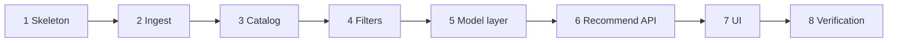

# Implementation Plan: Restaurant Recommendation System

Phase-wise plan for the service described in [architecture.md](architecture.md) and [problemStatement.md](problemStatement.md). Each phase leaves the repo runnable at a clear boundary. Later phases assume the earlier ones are done.

The workspace has a single architecture document, `architecture.md`. This plan follows that document.

## How to use this plan

Work the phases in order. A phase is finished when its exit checks pass. Stay inside the phase’s files so filter tests never need a live model, and the model is never asked to supply restaurant facts.



The default provider is Groq through its OpenAI-compatible chat API. `LLM_BASE_URL` defaults to `https://api.groq.com/openai/v1` and `LLM_MODEL` defaults to `openai/gpt-oss-120b`. The key stays in `LLM_API_KEY`. Phases 1–4 do not call the model. Phase 3 only sets those defaults. A different OpenAI-compatible provider is a change to `LLM_BASE_URL` and `LLM_MODEL`, not a code change.

Groq limits for `openai/gpt-oss-120b` are 30 requests/minute, 1,000 requests/day, 8,000 tokens/minute, and 200,000 tokens/day. Reasoning tokens count toward the token limits. One search sends one completion, so the request caps are loose. The 8,000 token minute cap is the bound on a single call: prompt tokens plus `max_tokens` must stay within it. A 429 or an over-budget call uses the fallback ranker instead of retrying.

| Phase | Outcome | Live dataset | Live model |
| --- | --- | --- | --- |
| 1. Skeleton | App boots, config loads, missing catalog fails with a clear message | No | No |
| 2. Ingest | `data/restaurants.parquet` and `data/catalog_meta.json` | Yes, once | No |
| 3. Catalog and meta | `GET /api/meta` serves localities and cuisines. Groq is the default provider, and the model is not called | Uses parquet | No |
| 4. Filters | Shortlist, budget bands, relaxation, pre-rank | Fixture rows in tests | No |
| 5. Model layer | Prompt, JSON parse, fallback ranker against Groq `openai/gpt-oss-120b` | No | Mocked in tests |
| 6. Recommend API | `POST /api/recommendations` joins ids to catalog facts | Uses parquet | Mocked in tests |
| 7. UI | Form and cards on one page | Uses parquet | Optional |
| 8. Verification | Scripted checks plus the four manual scenarios | Yes | Yes, and one run with the key removed |

## Phase 1 — Project skeleton

**Goal.** A Python 3.11 package that starts, reads configuration, and refuses to serve when the cleaned catalog is missing.

**Create**

- `pyproject.toml` with FastAPI, Uvicorn, Pydantic, `datasets`, `pandas`, `pyarrow`, `httpx`, and `pytest`.
- `app/config.py` for budget bands, relaxation order, `CANDIDATE_LIMIT` (15), `DEFAULT_TOP_N` (5), max `top_n` (8), explanation length cap, and preference text cap (300). Read `LLM_API_KEY`, `LLM_BASE_URL`, `LLM_MODEL`, and `LLM_TIMEOUT_SECONDS` from the environment. When `LLM_BASE_URL` or `LLM_MODEL` is unset, use Groq: `https://api.groq.com/openai/v1` and `openai/gpt-oss-120b`.
- `.env.example` with an empty `LLM_API_KEY`, the Groq base URL, and `openai/gpt-oss-120b`, plus `CANDIDATE_LIMIT`, `DEFAULT_TOP_N`, and `LLM_TIMEOUT_SECONDS`. Real keys stay in `.env`, which is gitignored.
- `.gitignore` for `.env`, `data/`, `__pycache__/`, and `.venv/`.
- `app/main.py` that constructs the FastAPI app and, on startup, checks that `data/restaurants.parquet` exists. When it does not, raise an error that tells the operator to run the ingest script.
- Empty modules matching the layout in architecture section 10: `app/schemas.py`, `app/catalog.py`, `app/filters.py`, `app/prompt.py`, `app/llm.py`, `app/ranker.py`, `pipeline/ingest.py`.

**Exit checks**

- `python -c "from app.config import settings"` succeeds.
- Starting the app before ingest exits with the ingest instruction.
- `.env` is absent from git.

## Phase 2 — Ingest pipeline

**Goal.** Turn the Hugging Face dataset into one row per restaurant, small enough to load in memory and safe to send to a model.

**Script:** `pipeline/ingest.py`

Run once before the API, and again only when the dataset should be refreshed. The request path never downloads Hugging Face data.

**Tasks**

1. Load `ManikaSaini/zomato-restaurant-recommendation` with `datasets`.
2. Normalize text: strip whitespace, split comma-separated `cuisines`, `rest_type`, `dish_liked`, and `listed_in(type)` into lists.
3. Parse `rate` into a float from 0 to 5. Treat `NEW`, `-`, and blank as missing.
4. Parse `approx_cost(for two people)` into an integer. Remove commas. Treat blank as missing.
5. Map `online_order` and `book_table` from `Yes` / `No` to booleans.
6. From `reviews_list`, keep at most two excerpts, each truncated to about 280 characters. Drop the raw column.
7. Drop `url`, `phone`, and `menu_item`.
8. Build a stable id from lowercase `name` plus normalized `address`.
9. Deduplicate on that id. Union list fields. Keep the highest `votes` and the rating attached to that vote count. Keep a non-null cost and a non-null snippet when any duplicate has one. Collect `listed_in(city)` into an area list.
10. Drop rows with no name. Keep rows that lack a rating or a cost.
11. Write `data/restaurants.parquet` and `data/catalog_meta.json` (sorted localities, sorted cuisines, restaurant count).
12. Print a cost histogram and the count of rows in each budget band so the bands in `app/config.py` can be confirmed:
    - low: cost for two ≤ 500
    - medium: 501 to 1,000
    - high: above 1,000

**Tests:** `tests/test_ingest.py`, using small in-memory frames. Cover `4.1/5`, `NEW`, `-`, blank rate, cost values `800` and `1,200`, two rows of the same name and address with different `listed_in(type)`, and a row with no name.

**Exit checks**

- Tests pass without downloading the dataset.
- One local ingest run finishes and writes both data files.
- Parquet has no `phone`, `url`, `menu_item`, or raw `reviews_list` column.
- Re-running ingest on the same download produces the same ids.

## Phase 3 — Catalog and meta API

**Goal.** The process loads the parquet catalog once and the form can ask what localities and cuisines exist. Groq is the configured model provider. This phase does not send a completion request.

**Tasks**

1. Define `Restaurant` in `app/schemas.py` with the cleaned fields: `id`, `name`, `address`, `location`, `areas`, `cuisines`, `cost_for_two`, `rating`, `votes`, `rest_type`, `online_order`, `book_table`, `dish_liked`, `listed_types`, `review_snippet`.
2. Implement `app/catalog.py`:
    - load parquet and meta at startup into memory
    - `list_localities()` and `list_cuisines()` from the parquet rows, so a stale `catalog_meta.json` cannot hide a locality or cuisine that is present in the file
    - `filter(preferences)` delegated in Phase 4
    - `get_many(ids)` preserving the caller’s id order, skipping unknown ids, and returning one entry when an id is repeated
3. Add `GET /api/meta`. Response includes localities, cuisines, budget options `low` | `medium` | `high`, and the default minimum rating `0`.
4. Replace the Phase 1 existence check with a real catalog load. A missing or unreadable parquet still fails startup with the ingest instruction. An empty parquet starts and serves empty locality and cuisine lists.
5. Set the default provider to Groq in `app/config.py` and `.env.example`: `LLM_BASE_URL=https://api.groq.com/openai/v1` and `LLM_MODEL=openai/gpt-oss-120b`. Leave `LLM_API_KEY` empty in the example. The catalog load and `GET /api/meta` must not call Groq.

**Exit checks**

- `GET /api/meta` returns 200 and includes `Banashankari` among localities after a real ingest.
- `get_many` on a known id returns that restaurant, and an unknown id is omitted.
- A second request does not reload parquet from disk.

## Phase 4 — Filters, budget, pre-rank, relaxation

**Goal.** Given preferences, produce a capped candidate list and a record of which constraints actually ran. This phase does not call a model.

**Tasks**

1. Add the preference model in `app/schemas.py`:

    | Field | Rule |
    | --- | --- |
    | `location` | Required. Case-insensitive match to a known locality. |
    | `budget` | Required. `low`, `medium`, or `high`. |
    | `cuisine` | Optional. Blank means any cuisine. |
    | `min_rating` | Optional, 0 to 5, default 0. Above 0 excludes missing ratings. |
    | `additional_preferences` | Optional, max about 300 characters. |
    | `top_n` | Optional, default 5, maximum 8. |

2. Implement hard filters in `app/filters.py`. A row matches when location equals the locality, a cuisine token equals the requested cuisine when one was provided, rating meets `min_rating` when that value is above 0, and `cost_for_two` falls in the budget band. Missing cost fails the budget filter.
3. Pre-rank with `score = rating * log(1 + votes)`. Missing ratings sort last. Keep the top `CANDIDATE_LIMIT` (15).
4. When fewer than 3 restaurants match, relax in order and stop as soon as 3 or more match:
    1. Widen budget by one adjacent band (`low` also allows medium, `medium` allows low and high, `high` also allows medium).
    2. Drop the cuisine constraint.
    3. Lower `min_rating` by 0.5, down to 0.
5. Leave location fixed. Record every relaxation on `filters_applied.relaxed`.
6. When the relaxed query is still empty, return an empty candidate list and a summary that asks the user to change locality or rating. Do not mark this path as a model call.

**Tests:** `tests/test_filters.py` with a handful of fixture restaurants. Cover an exact locality and cuisine hit, a missing cost excluded by budget, an unrated row kept at `min_rating = 0` and dropped above 0, score ordering, the 15-candidate cap, each relaxation step, and a location that matches nothing.

**Exit checks**

- Unknown locality or cuisine is detectable here so Phase 6 can return 400 with a short suggestion list.
- Filter tests pass with no network and no API key.
- An empty relaxed result does not invoke the LLM client.

## Phase 5 — Prompt, model client, and fallback

**Goal.** Rank a candidate list with Groq’s OpenAI-compatible chat completion (`openai/gpt-oss-120b` unless `LLM_MODEL` is overridden), and still return a deterministic list when that call fails.

**Tasks**

1. `app/prompt.py` builds one system message and one user message. The user message contains preferences plus at most 15 candidates. Each candidate includes `id`, `name`, `cuisines`, `rating`, `votes`, `cost_for_two`, `rest_type`, `listed_types`, a capped `dish_liked`, `online_order`, `book_table`, and `review_snippet` when present.
2. Instruct the model to rank only those ids, use `additional_preferences` as the tie-breaker, explain each pick in two or three sentences from the supplied fields, write a short `summary`, return JSON only, and emit at most `top_n` items:

    ```json
    {
      "summary": "string",
      "recommendations": [
        { "id": "string", "rank": 1, "explanation": "string" }
      ]
    }
    ```

3. `app/llm.py` calls `POST {LLM_BASE_URL}/chat/completions` once, with temperature `0.2` and `LLM_TIMEOUT_SECONDS` (20). The default base URL is `https://api.groq.com/openai/v1` and the default model is `openai/gpt-oss-120b`. Before the request, a shared in-memory budget reserves a high estimate of the prompt plus `max_tokens`, and that sum must fit in both the remaining 8,000 tokens for the minute and the remaining 200,000 for the day. The same windows enforce 30 requests/minute and 1,000 requests/day. After a success, the reservation is replaced with `usage.total_tokens` (reasoning tokens included). A blank key, a local budget refusal, or HTTP 429 does not retry; the ranker uses the fallback. A timeout keeps the worst-case reservation so a second call cannot slip past the cap. Strip markdown fences before parsing JSON.
4. Discard ids that are absent from the candidate set, and discard duplicate ids. If no valid id remains, use the fallback.
5. Fallback ranker keeps pre-rank order, takes `top_n`, and writes a plain explanation from rating, votes, cuisine, and cost. Its summary says the list is ordered by rating and popularity because a written recommendation was unavailable.
6. Set `explanation_source` to `llm` or `fallback`.

**Tests:** `tests/test_ranker.py` with a fake HTTP client. Cover valid JSON, fenced JSON, an unknown id dropped while a known id is kept, a timeout, a non-JSON body, and an empty recommendation array. Assert fallback order matches the pre-rank score.

**Exit checks**

- Tests pass with no real API key.
- Pointing at another OpenAI-compatible provider is a change to `LLM_BASE_URL` and `LLM_MODEL`. No ranker code changes. Groq and `openai/gpt-oss-120b` stay the defaults.

## Phase 6 — Recommendation API

**Goal.** One endpoint runs validation, filtering, ranking, and the catalog join.

**Route:** `POST /api/recommendations`

**Tasks**

1. `app/ranker.py` orchestrates the path:
    - validate preferences against the loaded catalog
    - filter, relax, and cap
    - on an empty shortlist, return 200 with an empty `recommendations` array and guidance in `summary`
    - otherwise call the model layer
    - join surviving ids through `catalog.get_many` so name, cuisines, rating, cost, address, restaurant type, online order, and table booking come from the catalog
2. Response shape matches architecture section 7: `summary`, `explanation_source`, `filters_applied`, `candidate_count`, and `recommendations` in rank order.
3. Status codes:
    - 200 for a ranked list, an empty list, or a fallback list
    - 400 for an invalid payload, unknown locality, or unknown cuisine, with suggested values when any exist
    - 500 only when the catalog failed to load (startup already prevents this in normal runs)

**Tests:** extend `tests/test_ranker.py` with the FastAPI test client. Cover a happy path with a mocked model, a 400 for an unknown locality, an empty 200 that never calls the model, and a provider error that still returns 200 with `explanation_source = "fallback"`.

**Exit checks**

- Every recommendation id exists in the candidate set from that request.
- Displayed rating and cost match the parquet row, including when the mocked model text mentions different numbers.
- `candidate_count` is the size of the shortlist before `top_n` is applied, and at most 15.

## Phase 7 — User interface

**Goal.** A single page, served by the same process, that collects preferences and renders the API response.

**Create** `app/static/index.html`, `app/static/app.js`, and `app/static/styles.css`. Mount the static files from `app/main.py`.

**Tasks**

1. On load, call `GET /api/meta`. Fill the locality dropdown and cuisine suggestions. Budget is a select of low, medium, and high. Minimum rating is a slider from 0 to 5. Extra preferences are a text box.
2. Submit sends `POST /api/recommendations`. Disable the button while the request is in flight.
3. Status line shows the filters that ran, any entries in `filters_applied.relaxed`, and a note when `explanation_source` is `fallback`.
4. Show `summary` when the list is non-empty.
5. Render one card per recommendation, in rank order: name, cuisines, rating, estimated cost for two, and explanation. Address and restaurant type sit under the name in smaller type.
6. Empty state tells the user to pick another locality or a lower rating. A 400 shows the suggested localities or cuisines from the error body.

**Exit checks**

- Opening `/` loads localities from the catalog.
- A search for Banashankari, medium budget, and Italian shows cards whose cost and rating match the API JSON.
- The button cannot be double-submitted during a request.

## Phase 8 — Verification

**Goal.** Confirm the full path against the real catalog and a real model, including the failures the architecture calls out.

**Automated**

- `pytest` is green.
- Ingest tests, filter tests, and ranker tests still make no live model call.

**Manual scenarios**

| Scenario | Expected |
| --- | --- |
| Banashankari, medium budget, Italian, minimum rating 4 | Several cards. Each name exists in the catalog. Explanation mentions cuisine, cost, or rating from that row. |
| A locality with a cuisine and rating combination that survives no relaxation | Empty state and guidance. No model error banner. |
| Same search with `LLM_API_KEY` removed | Cards still appear. Status line shows the fallback ranker. Order follows rating and votes. |
| Additional preference text “quick service” | With a working key, at least one explanation refers to restaurant type or a similar signal from the candidate payload, such as Quick Bites. |
| Location text `Delhi` | 400 and locality suggestions. Delhi is a city example in the problem statement; this dataset stores Bangalore localities. |
| Cost histogram from Phase 2 | If a band is almost empty, adjust the thresholds in `app/config.py` and re-run the filter tests before calling the bands final. |

**Exit checks**

- All four architecture walkthroughs pass against Groq `openai/gpt-oss-120b`: a rich Italian query, an empty query, fallback with the key removed, and a free-text preference visible in an explanation.
- Phone numbers are absent from the UI and from the prompt payload.

## Suggested work split

| Session | Phases | Stop when |
| --- | --- | --- |
| 1 | 1 and 2 | Parquet and meta JSON exist, ingest tests pass |
| 2 | 3 and 4 | Meta endpoint and filter tests pass |
| 3 | 5 and 6 | Recommend endpoint passes with a mocked model and with fallback |
| 4 | 7 and 8 | The page completes the manual table |

## Out of scope for this plan

These are named in the architecture as later options, and they are not part of the phases above:

- Replacing the in-memory catalog with a database
- A separate frontend toolchain
- Accounts, saved searches, or a review store
